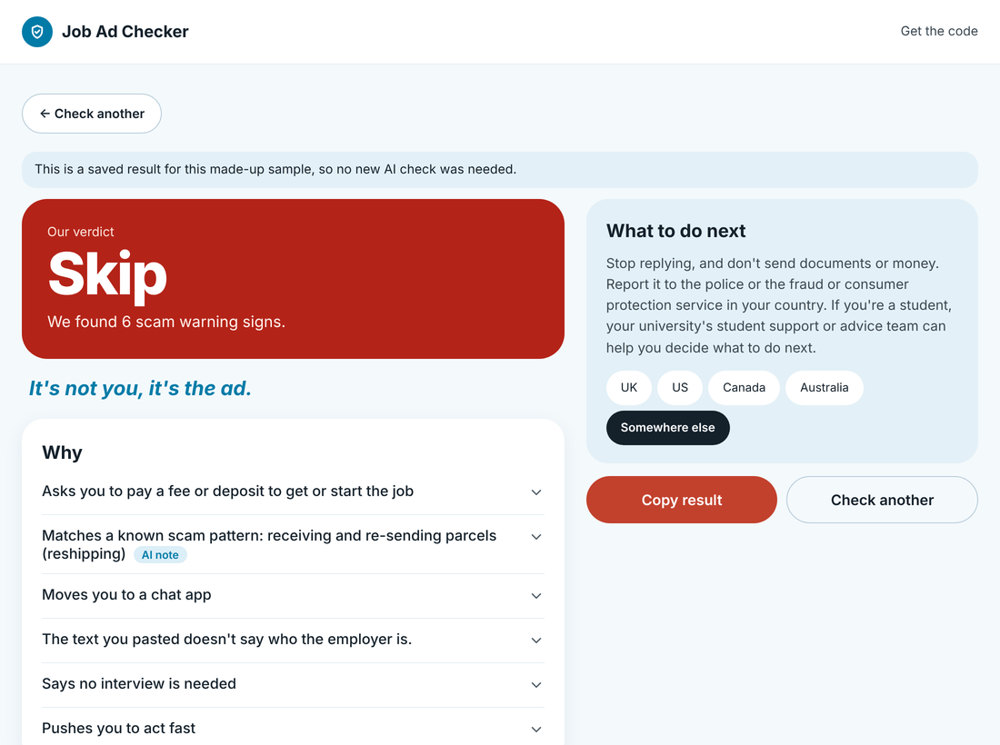

# Job Ad Checker

**Paste a job ad or recruiter message and get a calm verdict (No red flags found, Be careful, or Skip) in under a minute, with every warning sign quoted from the ad itself.**

**[Try the demo](https://yellow-sparkle.github.io/job-ad-checker/)**: three sample ads with saved results from real checks. Nothing you type is sent anywhere.



*"It's not you, it's the ad."*

## Why it exists

Job seekers lose evenings to ghost jobs (ads for roles that don't really exist) and lose money or their identity to job scams. Job Ad Checker reads an ad, a LinkedIn, WhatsApp or Telegram recruiter message, or an offer letter, and tells you whether to go ahead, be careful, or skip it, and why.

## How it works

- **The verdict is set by fixed rules, not by the AI.** Any sure sign of a scam gives Skip. A strong sign gives at least Be careful. Two weak signs give Be careful.
- **The AI can only add warnings it can back with a quote from the ad.** If the quoted line isn't in the text, the warning is dropped, so it can't invent reasons.
- **Some checks don't use the AI at all,** such as chat-app contact, gift cards and crypto payment, a free email address for a named company, and link shorteners. A line hidden in the ad to fool AI tools can't switch them off.
- **Nothing is saved.** No database, no log of what you paste, no cookies, no accounts. Emails, phone numbers and personal links are removed before the text is sent to the AI.

## Results

All numbers are the **worst of 3 runs**, because AI answers can change from run to run.

| Test | Scams caught | False alarms (a normal ad marked Skip) | Notes |
|---|---|---|---|
| Real ads, batch 1 (58 ads) | 17 of 17 | 0 of 41 | Rules tuned on this batch |
| Real ads, batch 2 (25 ads, unseen) | 8 of 10 | 0 of 15 | First run, before any fix |
| Golden set (65 made-up ads) | 29 of 29 | 0 of 31 | All 65 verdicts accepted |

**0 false alarms on 56 normal real ads** across both batches.

**What went wrong, and what I changed.** Batch 2 was a fair test: the app wasn't changed before it ran. It missed 2 scams:

- **RB04**, a cruise-ship job that wrote its Gmail address without the "@" so filters couldn't read it. Fix: a new check for disguised email addresses.
- **RB09**, a cold message offering a paid moderator role on an NFT game. Fix: a new check for cold crypto, NFT or Web3 job offers that mention no interview.

Both now get Be careful in all 3 runs, and nothing changed on batch 1 or the golden set.

**Honest caveats**

- The rules were tuned after seeing both batches, so neither is an unseen test any more. **A fresh batch 3 of real ads is still to come** and will be the real check of these fixes.
- The test ads and run files aren't published. The real ads can contain other people's names and contact details, and keeping the golden set private keeps it a fair test.
- Against free ChatGPT on the golden set (one ChatGPT run), the app got 100% of verdicts right and ChatGPT 93%. My original bar was "10 points better than ChatGPT", so that bar failed at 7 points.

Full tables: [batch 1 and golden set](eval/real-ads-final-results.md), [unseen batch 2](eval/unseen-v2-results.md).

## Run it on your computer

There is no online version. You run it on your own computer with your own [Anthropic API key](https://console.anthropic.com/), so you pay for your own checks (about 1 to 2 cents each). You also need Python 3.10 or newer.

```bash
git clone https://github.com/Yellow-sparkle/job-ad-checker.git
cd job-ad-checker
pip3 install -r app/requirements.txt
export ANTHROPIC_API_KEY=your-key-here
python3 app/server.py
```

Then open http://localhost:8000. The page has three "Try a sample ad" buttons (made-up ads) to see each verdict. Press Ctrl+C in the terminal to stop it.

Optional settings: `CHECKER_MODEL` (default `claude-sonnet-5-5`), `PORT` (default 8000), and spending caps `DAILY_AI_CHECKS` (default 200) and `SPEND_CAP_USD` (default 10). When a cap is reached, or the AI is unavailable, the app gives a clearly labelled rules-only result.

Offline tests (no key, no cost):

```bash
python3 -m unittest discover app/tests
```

To rebuild the demo page (`docs/index.html`) after changing the checker: run `python3 app/save_samples.py` once with your key (it checks the three sample ads for real, about 3 cents), then `python3 app/build_demo.py` (no key, no cost).

More detail: [app/README.md](app/README.md). Evaluation scripts: [eval/HOW-TO-RUN.md](eval/HOW-TO-RUN.md).

## Limits

- **English only.** It works on ads from any country, but only in English.
- **Not legal advice,** and not a guarantee. "No red flags found" means no known warning signs were found, not that a job is safe. If something feels wrong, trust that.
- Tested on 65 made-up ads and 83 real ads. A scam built in a new way can still get through.
- It runs only on your own computer, with your own Anthropic API key.
- The privacy page and terms in `legal/` are drafts for a possible future launch and are not in use.

## Product docs

This was my capstone project, and I'm a product manager, so the thinking is part of the work:

- [Product requirements (PRD)](docs/job-ad-checker-prd.pdf): the problem, the user (Mia), the core workflow, metrics and guardrails.
